# GIT_INVADERS.EXE

<p align="center">
  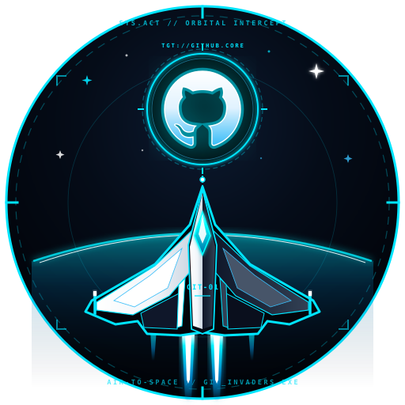
</p>

```text
 ██████╗ ██╗████████╗   ██╗███╗   ██╗██╗   ██╗ █████╗ ██████╗ ███████╗██████╗ ███████╗
██╔════╝ ██║╚══██╔══╝   ██║████╗  ██║██║   ██║██╔══██╗██╔══██╗██╔════╝██╔══██╗██╔════╝
██║  ███╗██║   ██║      ██║██╔██╗ ██║██║   ██║███████║██║  ██║█████╗  ██████╔╝███████╗
██║   ██║██║   ██║      ██║██║╚██╗██║╚██╗ ██╔╝██╔══██║██║  ██║██╔══╝  ██╔══██╗╚════██║
╚██████╔╝██║   ██║██╗   ██║██║ ╚████║ ╚████╔╝ ██║  ██║██████╔╝███████╗██║  ██║███████║
 ╚═════╝ ╚═╝   ╚═╝╚═╝   ╚═╝╚═╝  ╚═══╝  ╚═══╝  ╚═╝  ╚═╝╚═════╝ ╚══════╝╚═╝  ╚═╝╚══════╝
```

<p align="center">
  
  
  
  
  
  
  
</p>

> **`GIT_INVADERS.EXE`** es un arcade retro-futurista 2.5D procedural construido íntegramente con **TypeScript, Canvas 2D, SVG Path2D y Web Audio API**. El motor analiza telemetría real de repositorios y perfiles de GitHub y la transforma, mediante un pipeline de **Repository DNA**, en **14 naves de combate con extrusión 2.5D multicapa** (más nave procedural por repositorio), **11 arquetipos de enemigos tácticos**, **8 zonas de combate 2.5D con islas apiladas de 8 capas**, modificadores de combate por lenguaje y **10 arquetipos de Code Bosses de 4 fases** con submódulos destructibles, mutaciones genéticas y síntesis de audio reactiva (**AudioDNA**).

---

## 📸 Galería Visual de la Suite Arcade

### Panel 1: Hangar Táctico 2.5D, Flota de 14 Naves, Dossier del Boss y Directivas en Vivo

*Vista panorámica con selector lateral y tira rápida de las 14 naves, plataforma holográfica 2.5D, telemetría de ADN del repositorio, Boss Genome de 6 barras y panel inferior de directivas de misión.*
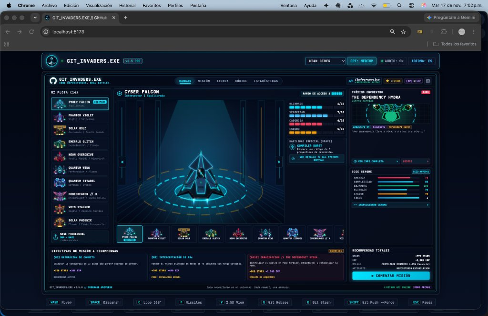

---

### Panel 2: Combate Aéreo en Horizonte 2.5D, Islas Multicapa, Nubes y HUD de Vuelo

*Combate activo en 2.5D con horizonte curvo, islas de 8 capas, estelas alares, búnkeres extruidos, misiles teledirigidos (`[F]`), acrobacia loop (`[C]`), vista conmutable (`[V]`) y selector de zonas (`[Z]`).*
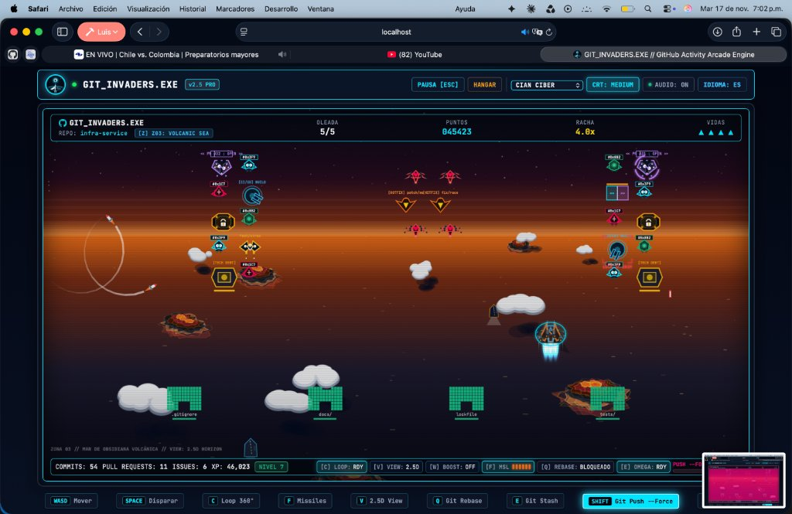

---

### Panel 3: Enciclopedia de los 10 Code Bosses y Suite Completa

*Arquetipos modulares con anatomía diferenciada, fases terminales y ataques únicos por repositorio.*
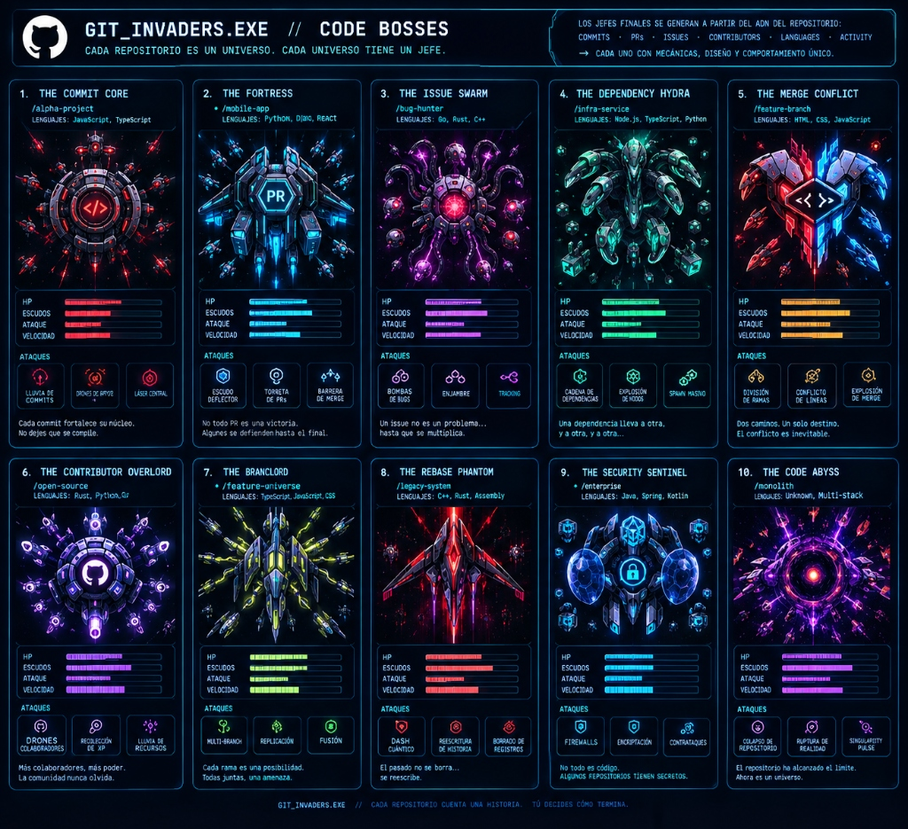
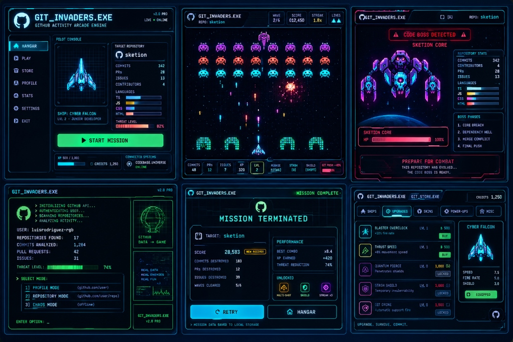

---

### Panel 4: Hangar Original, Combate Clásico, Inspector de Genoma y Tienda (`GIT_STORE.EXE`)

*Vistas adicionales de telemetría forense (`#A15BF6`), terminal BIOS, debriefing de rendimiento y tienda de mejoras en `localStorage`.*
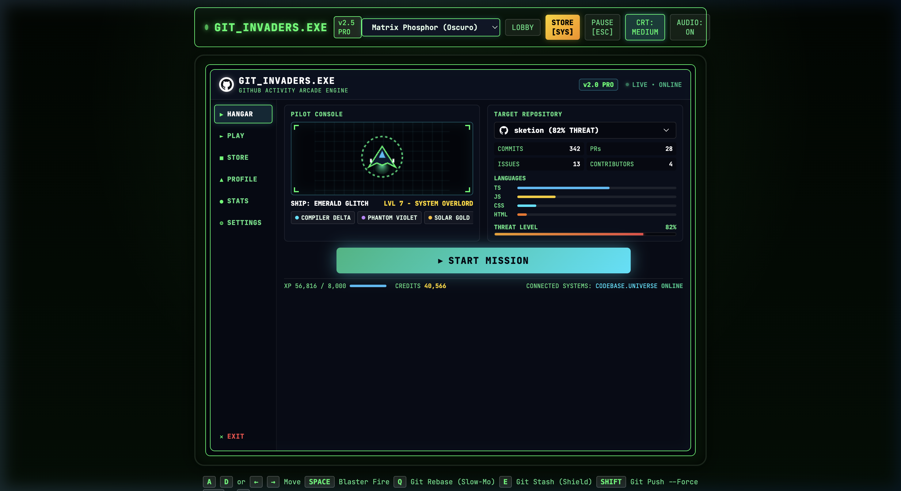
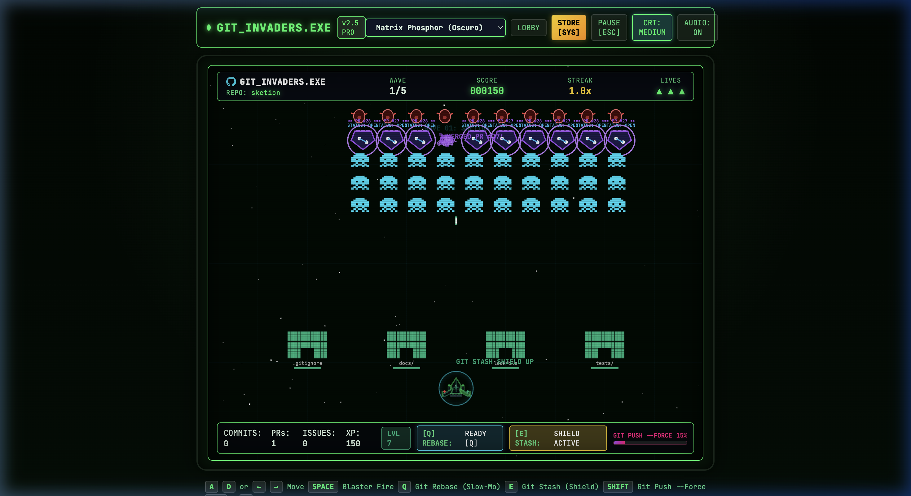
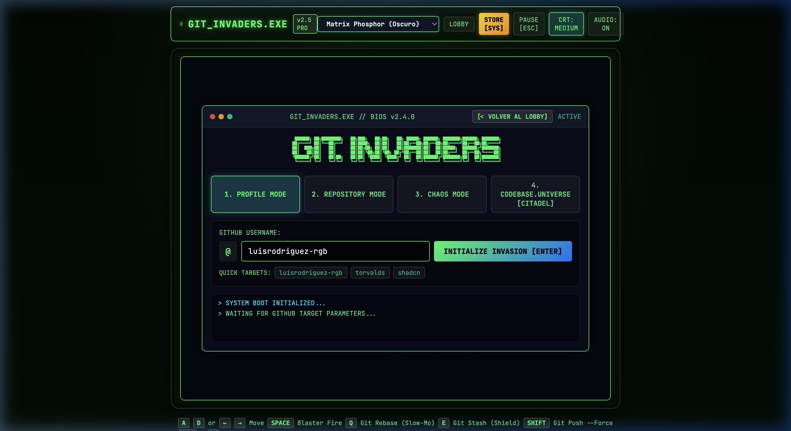
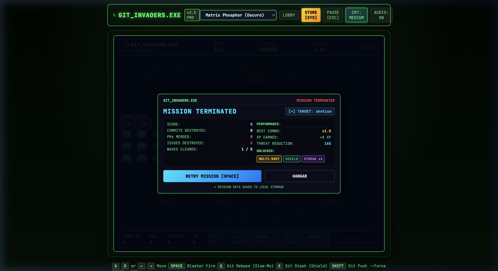
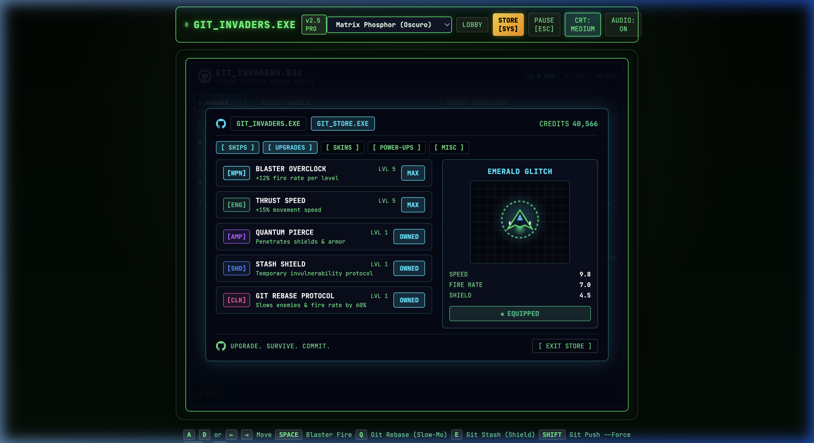
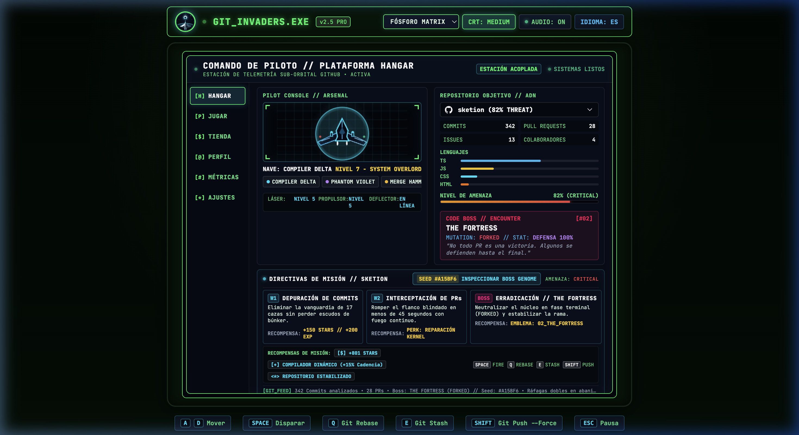

---

## 🎮 Modos de Juego

1. **Repository Incursion (`usuario/repositorio`):**

   - Escanea un repositorio específico de GitHub (ej. `facebook/react`, `luisrodriguez-rgb/GIT_INVADERS.EXE`, `torvalds/linux`).
   - Extrae métricas reales (commits, PRs, issues, colaboradores, lenguajes) y genera una campaña procedural de 3 oleadas culminando en su **Code Boss** exclusivo.
2. **Profile Assault (`@usuario`):**

   - Escanea el perfil público de un desarrollador en GitHub.
   - Modula el volumen de la flota enemiga y la dificultad en función del historial público de contribuciones y commits acumulados.
3. **Instant Chaos Mode (`CHAOS // MAX`):**

   - Simulación offline de máxima intensidad calibrada a 9,999 commits, 482 PRs y 731 issues.
   - Despliega oleadas de nivel de amenaza extremo con cadencia de disparo multiplicada e invasores enfurecidos.
4. **Codebase Universe Mode (`CITADEL`):**

   - Enlace directo con la infraestructura espacial interactiva 2.5D del universo de repositorios.

---

## 🧬 Pipeline Causal de Generación Procedural

El motor implementa un pipeline causal y determinista donde **ningún elemento visual o matemático es aleatorio**. Cada atributo del combate proviene directamente de los datos del repositorio analizado:

```text
                        ┌───────────────────────────────┐
                        │   GitHub REST API / Metrics   │
                        │ (Commits, PRs, Issues, Con.)  │
                        └───────────────┬───────────────┘
                                        ▼
                        ┌───────────────────────────────┐
                        │        Repository DNA         │
                        │ (Fingerprint & Threat Index)  │
                        └───────┬───────────────┬───────┘
                                │               │
                ┌───────────────┘               └───────────────┐
                ▼                                               ▼
┌───────────────────────────────┐               ┌───────────────────────────────┐
│     Ship Vector Synthesis     │               │     Boss Genome Synthesis     │
│ (8-Layer Procedural Geometry) │               │   (10 Archetypes + Mutations) │
└───────────────┬───────────────┘               └───────────────┬───────────────┘
                │                                               │
                │        ┌──────────────────────────────┐       │
                ├───────►│  Real-Time Game Engine       │◄──────┤
                │        │  - AI Movement Strategies    │       │
                │        │  - 4-Phase Boss StateMachine │       │
                │        │  - Collision & Hitboxes      │       │
                │        │  - Semantic Particles        │       │
                │        │  - Dynamic AudioDNA (Synth)  │       │
                │        └──────────────┬───────────────┘       │
                │                       ▼                       │
                └────────► Canvas 2D + SVG Path2D ◄─────────────┘
                                 (60 FPS)
```

---

## 🚀 Flota de Naves de Combate (14 Arquetipos Vectoriales 2.5D + Nave Procedural DNA)

El subsistema `ShipComposer` desacopla la geometría física de cada nave mediante extrusión vertical 2.5D multicapa (`withZLayer`), sombreado metálico (`fillIndustrialMetal` / `drawBeveledArmorPlate`) y subsistemas independientes:

1. **Extruded 2.5D Silhouette Base:** Capas inferiores desplazadas en profundidad para volumen real en vuelo y hangar.
2. **Engine Flares:** Gradiente radial con toberas mecánicas, fulgor reactivo y estelas alares en vuelo.
3. **Wings & Stabilizers:** Geometría alar exclusiva por arquetipo con planos biselados.
4. **Armored Hull Plating:** Placas cerámico-metálicas de alto contraste con nervaduras y remaches.
5. **Weapon Hardpoints:** Puntos duros balísticos con retroceso y conductos de energía.
6. **Multi-Strut Canopy Visor:** Carlinga titanio con vidrio refractivo y núcleo de aviónica.
7. **Navigation Strobe Lights & Structural Damage Layers:** Balizas estroboscópicas y fisuras por degradación.
8. **Hexagonal Wingtip Deflector:** Arco energético perimetral no intrusivo.

### 📋 Especificaciones Técnicas de la Flota (14 Naves + Nave Procedural)

| Nave | Geometría Física | Paleta Multi-Tono | Blindaje | Velocidad | Cadencia | Escudo | Habilidad Táctica (`E` / `Q` / `SPACE` / `SHIFT`) | Mecánica en Batalla |
| :--- | :--- | :--- | :---: | :---: | :---: | :---: | :--- | :--- |
| **CYBER FALCON** | `delta_interceptor` | Plata Perla / Cian / Acero | 60% | 70% | 60% | 50% | `COMPILER BURST` (`SPACE` / `E`) | Ráfaga triple de precisión y overclock temporal de cadencia (`E`). |
| **PHANTOM VIOLET** | `forward_swept` | Amatista / Violeta / Cian | 40% | 100% | 70% | 30% | `GIT STASH` (`E`) | Intangibilidad 3.5s, disparo activo en fase y abanico de 5 dagas al salir. |
| **SOLAR GOLD** | `hammerhead_ram` | Oro Solar / Bronce / Carmesí | 100% | 30% | 40% | 80% | `MERGE BURST` (`E`) | Absorbe impactos frontales y libera onda de choque cinética (`>= 40%`). |
| **EMERALD GLITCH** | `fractal_asymmetric` | Esmeralda / Lima / Cian | 50% | 80% | 60% | 50% | `BRANCH SPLIT` (`E`) | Despliega 2 drones tácticos que replican el fuego de armas durante 5.5s. |
| **NEON OVERDRIVE** | `ramjet_dragster` | Carmesí / Naranja / Oro | 40% | 90% | 90% | 20% | `GIT REBASE` (`Q` / `E`) | Carga hipercinética penetrante con invulnerabilidad y cámara lenta. |
| **QUANTUM WING** | `quantum_trimaran` | Turquesa / Índigo / Titanio | 50% | 70% | 60% | 60% | `QUANTUM PIERCE` (`SPACE` / `E`) | Lanzas cuánticas perforantes continuas y salva triple frontal (`E`). |
| **QUANTUM CITADEL** | `toroidal_ring` | Azul Real / Acero / Oro | 70% | 60% | 70% | 90% | `OCTO PROTOCOL` (`E`) | Genera 8 micro-drones orbitales que interceptan disparos enemigos. |
| **CODEBREAKER // X** | `x_dreadnought` | Magenta / Esmeralda / Violeta | 100% | 50% | 100% | 90% | `KERNEL LANCE` (`E`) / `PUSH --FORCE` (`SHIFT`) | Lanza de plasma concentrada y superláser de aniquilación global. |
| **VOID STALKER** | `stealth_dagger` | Titanio / Carmesí / Oro | 40% | 95% | 80% | 40% | `TEMPORAL RIFT` (`E`) | Ralentiza proyectiles un 80%, deja señuelo holográfico y salta al flanco opuesto. |
| **SOLAR PHOENIX** | `phoenix_swept` | Naranja Solar / Oro / Cian | 60% | 85% | 85% | 70% | `SUPERNOVA NOVA` (`E`) | Onda expansiva de plasma 360° que destruye balas enemigas + 10 llamas radiales. |
| **AEGIS VALKYRIE** | `valkyrie_swept` | Titanio Polar / Oro / Carmesí | 85% | 80% | 75% | 95% | `VALKYRIE AEGIS` (`E`) | Activa escudo reflector + lanza 4 micro-misiles sin gastar munición. |
| **CHRONO SERAPH** | `seraph_wings` | Amatista Prisma / Cian / Rosa | 65% | 90% | 85% | 85% | `SERAPH HALO` (`E`) | Pulso de halo temporal 360° + abanico de 6 lanzas cuánticas + sobrecarga. |
| **OBSIDIAN HYDRA** | `hydra_tri_hull` | Basalto / Esmeralda / Cian | 90% | 65% | 95% | 75% | `HYDRA BARRAGE` (`E`) | Salva de 4 misiles teledirigidos + 3 esferas pesadas de plasma ácido. |
| **STARFORGE OMEGA** | `starforge_cruiser` | Forja Naranja / Titanio / Cian | 95% | 75% | 100% | 90% | `OMEGA RAILSTORM` (`E`) | Superláser central + 2 lanzas cuánticas + recarga de 3 misiles. |
| **NAVE PROCEDURAL** | `fromRepository(...)` | ADN del Repositorio | Din. | Din. | Din. | Din. | `DNA OVERLOAD` (`E`) | Geometría y descarga vectorial calibradas desde métricas reales del repo (`DNA -> NAVE`). |

---

## 🌍 Las 8 Zonas de Combate 2.5D Multicapa

Todas las zonas renderizan horizonte atmosférico curvo (conmutable entre vista `ANGLED_25D` y `TOP_DOWN` con `V`), superficie marina/plasmática reflectante, **islas y ciudadelas apiladas en 8 capas de elevación**, **portaaviones aliados navegando con estelas en V** y **nubes volumétricas con sombra proyectada**:

| ID | Zona | Código HUD | Ambientación Multicapa |
| :---: | :--- | :--- | :--- |
| **Z01** | `ARCHIPELAGO_DIGITAL` | `[Z] Z01: ARCHIPELAGO` | Océano zafiro con reflejos solares e islas tropicales de arrecife, arena, selva y cumbres. |
| **Z02** | `CORAL_ATOLL_LAGOON` | `[Z] Z02: CORAL ATOLL` | Atolón turquesa cristalino con arrecifes coralinos y playas doradas. |
| **Z03** | `VOLCANIC_OBSIDIAN_SEA` | `[Z] Z03: VOLCANIC SEA` | Mar oscuro de obsidiana, cielo ámbar ceniciento e islas con cráteres magmáticos. |
| **Z04** | `CYBER_GLACIER_FJORD` | `[Z] Z04: GLACIER FJORD` | Fiordos árticos cibernéticos, banquisas celestes y cumbres nevadas. |
| **Z05** | `VERDANT_CANYON_DELTA` | `[Z] Z05: CANYON DELTA` | Delta esmeralda con mesas terracota y cañones escalonados. |
| **Z06** | `ATMOS_CYBER_GRID` | `[Z] Z06: CYBER GRID` | Océano ciber-cian con perspectiva Mode-7 sobre el agua e islas-ciudadela metálicas. |
| **Z07** | `DEPENDENCY_NEBULA` | `[Z] Z07: NEBULA` | Aurora violeta en el horizonte, mar bioluminiscente y archipiélagos de cristal. |
| **Z08** | `CORE_BREACH_HORIZON` | `[Z] Z08: CORE BREACH` | Arena de jefe con mar carmesí, vórtice de singularidad en el cielo y bastiones dorados. |

---

## 🛸 Los 11 Arquetipos de Enemigos Tácticos

| Enemigo | Clase / Tipo Visual | Mecánica y Comportamiento en Batalla |
| :--- | :--- | :--- |
| **Commit Invader** | Cyber-Cangrejo / Mantis / Avispón (`CommitRenderer`) | Invasores articulados coloreados según semántica Git (`feat`, `fix`, `merge`, `refactor`, `docs`). |
| **Armored PR** | Cañonera Mecha-Valkiria (`PRRenderer`) | Escudo deflector segmentado de 4 cuadrantes; suelta `multi_shot` o `stash_shield`. |
| **Issue Bomber** | Avispa Biomecánica (`IssueRenderer`) | Fijación láser roja cuando entra en picada hacia la posición del jugador. |
| **Merge Conflict** | Quimera Bicéfala dividida (`MergeConflict`) | Mitad cian vs mitad magenta atravesada por rayo; al morir se divide en 2 drakes `ConflictFragment`. |
| **Dependency Drone** | Cefalópodo Cibernético (`DependencyDrone`) | Nodo raíz con tentáculos y nodos satélite orbitantes que colapsan al caer la raíz. |
| **Branch Drone** | Interceptor Wyvern Bicéfalo (`BranchRenderer`) | Se bifurca en 2 sub-drones `α` y `β` tras la primera destrucción. |
| **Security Sentinel** | Mecha-Gólem Aegis (`SecurityRenderer`) | Yelmo cornudo con dos escudos hexagonales laterales y barrera Firewall alternante. |
| **Hotfix Interceptor** | Halcón Mecha de asalto (`HotfixInterceptor`) | Barrido sinusoidal de alta velocidad; al caer otorga 3s de sobrecarga de cadencia. |
| **Tech Debt Juggernaut** | Escarabajo Goliat de asedio (`TechDebtJuggernaut`) | Blindaje pesado (`110 HP`), auto-reparación pasiva y abanico triple; suelta `+2` misiles. |
| **Pipeline Turret** | Plataforma Escorpión CI/CD (`PipelineTurret`) | Torreta de cañones dobles giratorios que apunta dinámicamente hacia el jugador. |
| **Mystery Octocat** | Reconocimiento Orbital (`MysteryOctocat`) | Sobrevuelo especial de alta velocidad que otorga `+500 XP`, multi-disparo y recarga completa de misiles. |

---

## 👾 Los 10 Arquetipos de Code Bosses

Cada repositorio se clasifica matemáticamente en uno de los **10 arquetipos de Code Bosses**, con atributos de combate, ataques únicos, cotas de blindaje y fases terminales personalizadas:

| N° | Arquetipo | Concepto de Repositorio | Stat Especial | Ataque Principal | Ataque Secundario | Fase Terminal |
| :----------: | :--------------------------------- | :------------------------------------------------- | :---------------------: | :-------------------- | :---------------------- | :------------------- |
| **01** | **THE COMMIT CORE** | Alta frecuencia de commits y CI/CD continuo. | `SPAWN: 90%` | Lluvia de Commits | Drones de Historial | `HISTORY OVERFLOW` |
| **02** | **THE FORTRESS** | Alto volumen de Pull Requests y code reviews. | `DEFENSA: 100%` | Escudo Deflector | Torretas de PRs | `MERGE LOCK` |
| **03** | **THE ISSUE SWARM** | Rastreador con alta densidad de bugs y reportes. | `ENJAMBRE: 100%` | Bombas de Bugs | Ráfagas Erráticas | `CRITICAL BUG` |
| **04** | **THE DEPENDENCY HYDRA** | Árbol modular con dependencias interconectadas. | `COMPLEJIDAD: 100%` | Cadena Energética | Fragmentación de Nodos | `DEPENDENCY HELL` |
| **05** | **THE MERGE CONFLICT** | Ramas bifurcadas en conflicto `<<<<<<< HEAD`. | `CONFLICTO: 100%` | División de Ramas | Láser Cruzado en X | `UNRESOLVED` |
| **06** | **THE CONTRIBUTOR OVERLORD** | Ecosistema colaborativo con gran flota de autores. | `FLOTA: 100%` | Drones de Soporte | Sifón de Experiencia | `OPEN SOURCE ARMY` |
| **07** | **THE BRANCHLORD** | Múltiples ramas vivas y universos de features. | `RAMIFICACIÓN: 100%` | Disparos Split | Decoys Holográficos | `BRANCH COLLAPSE` |
| **08** | **THE REBASE PHANTOM** | Código legado reescrito con firma de sigilo. | `SIGILO: 100%` | Dash Cuántico | Rewind de Daño | `FORCE REBASE` |
| **09** | **THE SECURITY SENTINEL** | Arquitectura enterprise y políticas zero-trust. | `SEGURIDAD: 100%` | Barrera Firewall | Encriptación Aegis | `BREACH DETECTED` |
| **10** | **THE CODE ABYSS** | Monolito cósmico con complejidad gravitacional. | `SINGULARIDAD: 100%` | Colapso Gravitacional | Distorsión de Física | `SYSTEM LIMIT` |

---

## 🧪 Stack de Mutaciones Genéticas (Genetic Mutations)

El motor evalúa el nivel de amenaza (`threatLevel`) y aplica una **mutación primaria** y una **mutación secundaria** con sinergias de combate:

- **`OVERCLOCKED`:** +35% velocidad balística, +40% cadencia de fuego sostenido y drones en ráfaga rápida. Tempo de audio a 148 BPM.
- **`RECURSIVE`:** Los proyectiles emiten réplicas retardadas en cascada a 0.8s; submódulos que imitan las coordenadas del jugador.
- **`CORRUPTED`:** Trayectorias sinusoidales caóticas, minas de error y sintetizador bitcrush desafinado a -140 cents.
- **`DISTRIBUTED`:** Nodos satélite interconectados con red de daño compartido y fuego divergente.
- **`SECURED`:** Placas deflectoras rotatorias y pulso electromagnético EMP si el jugador activa sus escudos.
- **`LEGACY`:** Proyectiles cinéticos pesados con teleport de *History Rewind* que restaura blindaje perdido.
- **`FORKED`:** Chasis bifurcado simétrico con salvas dobles en abanico cruzado.
- **`UNSTABLE`:** Arcos de plasma radiante y ondas de choque de daño en área crítica.

---

## 🎵 Motor de Síntesis Reactiva AudioDNA

El audio en `GIT_INVADERS.EXE` se sintetiza en tiempo real utilizando la **Web Audio API** nativa de navegador (cero archivos `.mp3`/`.wav` externos):

- **BPM Adaptativo:** Modulado entre 96 BPM (código legado) y 148 BPM (proyectos overclockeados).
- **Escalas Armónicas Dinámicas:** Conmutación entre *D Minor Cyberpunk* (armónica menor) y *Locrian Glitch* (locria alterada con notas tritonales).
- **Efectos en Tiempo Real:** Nodos biquad filter, moduladores de onda sinusoidal/cuadrada/sierra, reverberación convolutiva y puertas de ruido adaptativas.

---

## ⚡ Modificadores de Combate por Lenguaje (Language Modifiers)

La composición porcentual de lenguajes del repositorio altera la física y mecánica del combate:

| Lenguaje / Ecosistema | Modificador Táctico | Efecto en Batalla |
| :-------------------------------- | :------------------------------------ | :---------------------------------------------------------------- |
| **TypeScript / JavaScript** | `Dynamic Compiler (+15% Fire Rate)` | Mayor cadencia de disparo y proyectiles de alta frecuencia. |
| **Python** | `Subprocess Drone Escort` | Spawnea drones de soporte orbital que asisten a la nave. |
| **Rust / C++** | `Zero-Cost Deflector Armor` | +25% de resistencia de casco y deflectores cinéticos reforzados. |
| **HTML / CSS** | `Defensive Bunker Hardening` | +30% de integridad estructural en búnkeres de contención. |
| **Go** | `Concurrent Goroutine Swarm` | Invocación de micro-nodos de ataque concurrente coordinado. |
| **Java / C#** | `Enterprise Object Shield` | Capa adicional de blindaje polimórfico contra daño por plasma. |

---

## 🕹️ Controles de Combate 2.5D

| Tecla / Control | Acción |
| :--- | :--- |
| `W` / `A` / `S` / `D` o `↑` / `←` / `↓` / `→` | Vuelo libre en el corredor 2.5D (`W` / `↑` activa postcombustión Boost) |
| `SPACE` | Disparar arma primaria exclusiva de la nave equipada |
| `C` | **Acrobacia Loop 360°** (voltereta evasiva con invulnerabilidad temporal) |
| `F` | Lanzar salva de **Misiles Teledirigidos** (6 cargas con recarga automática) |
| `V` | Conmutar cámara entre **2.5D Horizon** (`ANGLED_25D`) y **Top-Down Radar** (`TOP_DOWN`) |
| `Z` | Ciclar manualmente entre las **8 zonas 2.5D** en combate (o clic en el chip de zona del HUD) |
| `Q` | Activar **`GIT REBASE`** (ralentización temporal / dash cinético) |
| `E` | Activar la **Habilidad Táctica Exclusiva** de la nave equipada |
| `SHIFT` | Activar **`GIT PUSH --FORCE`** (superláser global al 100% de carga) |
| `ESC` o `P` | Pausar / Reanudar la simulación |
| **Touch & HUD Controls** | Botones táctiles en móvil y consola inferior/HUD interactivos en escritorio |

---

## 🛠️ Stack Tecnológico

```text
GIT_INVADERS.EXE
├── Core Logic: TypeScript 5.x (Strict Typing, State Machines, Procedural Math)
├── Rendering: Canvas 2D Engine + SVG Path2D Vectors (Zero External Images)
├── Audio: Web Audio API (Multi-Oscillator Subtractive Synthesis & AudioDNA)
├── Styling & CRT: Vanilla CSS (Scanlines, Phosphor Glow, Aberration Shaders)
├── Data Integration: GitHub REST API v3 (Octokit Octocat Pipeline)
└── Bundler: Vite 5.x (HMR, Tree Shaking, ESM Optimized Builds)
```

---

## 📦 Instalación y Ejecución Local

### Prerrequisitos

- **Node.js** (v18.0 o superior)
- **pnpm** (o `npm` / `yarn`)

### Pasos de Instalación

```bash
# 1. Clonar el repositorio oficial
git clone https://github.com/luisrodriguez-rgb/GIT_INVADERS.EXE.git
cd GIT_INVADERS.EXE

# 2. Instalar dependencias
pnpm install

# 3. Iniciar servidor de desarrollo local
pnpm dev

# 4. Compilar bundle de producción optimizado
pnpm build
```

---

## 👨‍💻 Autor y Licencia

Desarrollado y mantenido por **Luis Rodriguez** ([@luisrodriguez-rgb](https://github.com/luisrodriguez-rgb)).

<div align="center">
  <a href="https://github.com/luisrodriguez-rgb">
    
    <br/>
    <strong>Luis Rodriguez (luisrodriguez-rgb)</strong>
  </a>
</div>

<br/>

Distribuido bajo la Licencia **MIT**. Consulta el archivo `LICENSE` para más detalles.
